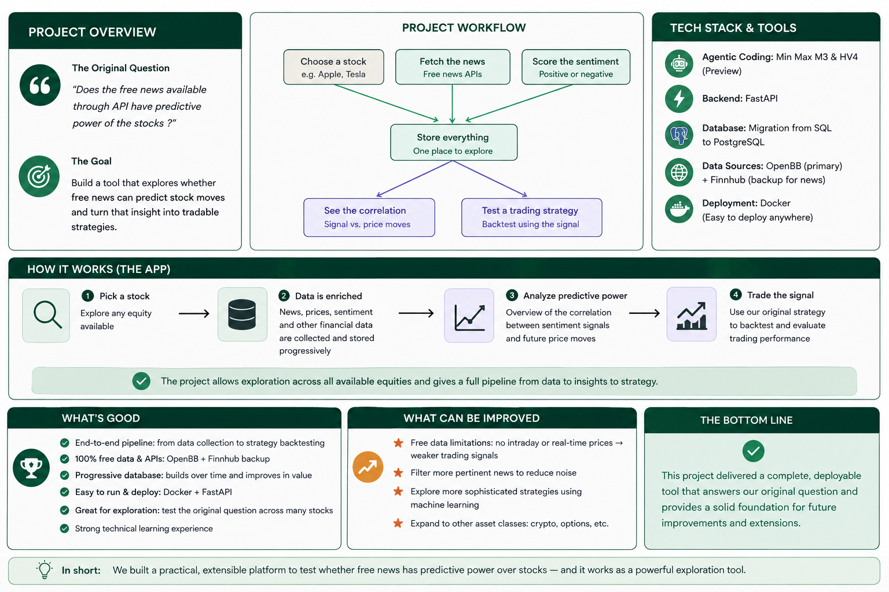

# Financial Sentiment Pipeline

> **Can we extract sentiment from financial news and turn it into a measurable
> market signal?**



Fetch financial news and prices from OpenBB (and Finnhub), score headlines with
FinBERT, store everything in PostgreSQL, and explore the results through a web UI
and a REST API.

```
OpenBB / Finnhub  ->  news  ->  FinBERT sentiment  ->  PostgreSQL  ->  API + UI
```

## Folder layout

| Path | Contents |
|---|---|
| `financial_sentiment/` | Installed package: providers, sentiment, repository, pipeline, strategy, API |
| `scripts/` | Runnable utilities: CLI launcher, local PostgreSQL, API server, backfills, recompute |
| `config/` | Dockerfile, dependency manifests, environment template |
| `docs/` | Setup, Docker, configuration, database, CLI, API, scoring, backtesting, architecture |
| `assets/` | Project overview poster |
| `pyproject.toml` | Package metadata for `pip install -e .` |
| `docker-compose.yml` | `api` + PostgreSQL 16 services |
| `README.md` | This index |

Only three visible files stay at the root, because the tools that consume them
look there by design: `pip install` reads `pyproject.toml`, `docker compose up`
reads `docker-compose.yml`, and GitHub renders `README.md`. Hidden dotfiles are
root-level too — in particular `.env`, which `config.py` loads from the project
root and Compose reads for `${...}` substitution. It is git-ignored and never
committed. Everything else is classified into a folder.

The code uses a flat layout: `financial_sentiment/` sits directly at the root,
with no `src/` wrapper. It keeps its own name because `pyproject.toml` registers
the `financial-sentiment` command and the web UI's static files under that name,
and every internal import is relative to it. See
[Architecture](docs/architecture.md) for the details.

## Quick start

### With Docker (recommended)

```bash
cp config/env.example .env        # optional: add GROQ_API_KEY
docker compose up --build         # API on :8000, PostgreSQL on :5432
```

Open `http://127.0.0.1:8000/`. The database schema is created on startup, so
there is no migration step. See [Docker](docs/docker.md) for the full command
reference.

### Without Docker

```bash
pip install -r config/requirements.txt
pip install -r config/requirements-dev.txt   # adds the bundled local PostgreSQL

cp config/env.example .env       # then set DATABASE_URL
python scripts/pg_server.py start

python scripts/main.py --symbols AAPL MSFT --start-date 2026-07-01 --end-date 2026-08-28 --analyze
python scripts/run_api.py          # http://127.0.0.1:8000
```

See [Getting started](docs/getting-started.md) for the full walkthrough.

## Documentation

| Guide | Contents |
|---|---|
| [Getting started](docs/getting-started.md) | Local and Docker setup, first pipeline run |
| [Docker](docs/docker.md) | Compose commands, image layout, provider keys |
| [Configuration](docs/configuration.md) | Environment variables and provider fallback order |
| [Database](docs/database.md) | PostgreSQL, schema, forward returns |
| [CLI](docs/cli.md) | Command flags, coverage guards, programmatic use |
| [API & web UI](docs/api.md) | Endpoint reference and request examples |
| [Sentiment scoring](docs/sentiment.md) | FinBERT and the optional Groq LLM backfill |
| [Backtesting](docs/backtesting.md) | Strategies, metrics, comparison and optimizer |
| [Architecture](docs/architecture.md) | Package structure and data flow |

## Requirements

Python 3.10+ and PostgreSQL (bundled locally or via Docker). The ML stack is
pinned in `config/requirements.txt`; see [Configuration](docs/configuration.md)
for the environment variables.
